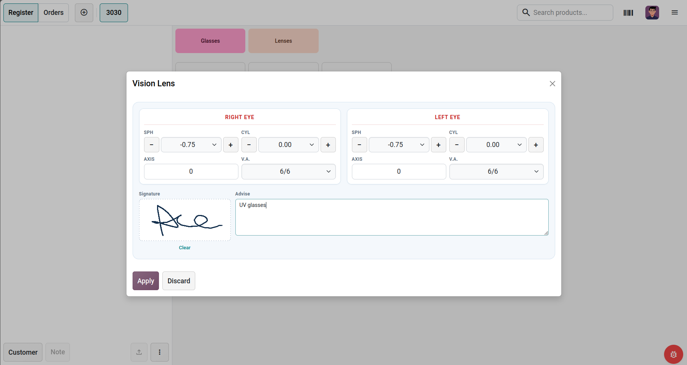
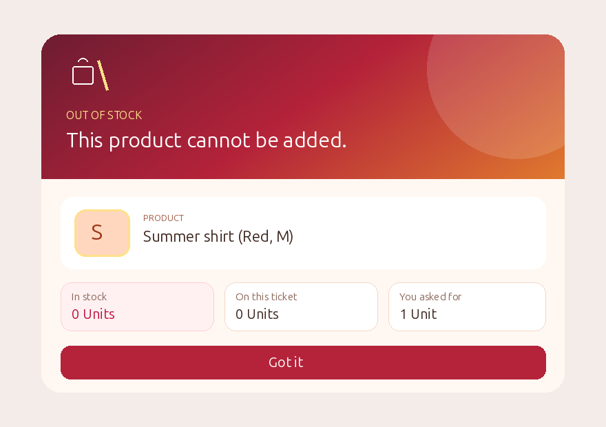

# Odoo Apps

Point of Sale modules for **Odoo 20**, built by [Dynasol Technologies](https://dynasol.pk).

Each folder is a standalone addon. Clone the **20.0** branch, add this repository to your addons path, and install the app you need.

[](https://github.com/imrantechexpert/odoo_apps/tree/20.0)
[](LICENSE)

## Modules

| | Module | What it does |
| --- | --- | --- |
|  | **[POS Vision Lens](pos_vision_lens)** | Prescription card on the till for optical shops. Right eye and left eye, SPH, CYL, axis, visual acuity, advise, and a signature, saved on the order line. |
|  | **[POS Restrict Negative Sale](pos_restrict_negative_sale)** | Blocks a sale when the product or variant has no free quantity left in that shop. The line is not added, and payment is checked again on the server. |

## POS Vision Lens

Sell a lens and a card opens. Frames and accessories stay normal. Only products marked **Vision Lens** open the card.

<p align="center">
  
</p>

- SPH from -20.00 to +20.00 and CYL from -6.00 to +6.00, in steps of 0.25, with minus and plus buttons.
- Visual acuity choices: 6/6, 6/9, 6/12, 6/18, 6/24, 6/36, 6/60, CF, HM.
- Axis, advise, and a signature drawn on screen.
- Powers and acuity lists are editable under **Point of Sale → Configuration → Prescription Values**.
- The same card is on the POS order afterwards, and a short receipt prints shop, customer, and lines.
- Two lenses on one ticket keep two cards.

<p align="center">
  
</p>

Depends on **Point of Sale**. Full notes: [pos_vision_lens/README.md](pos_vision_lens/README.md).

## POS Restrict Negative Sale

A tap on an empty product, or on an empty variant, opens an out-of-stock window and leaves the ticket unchanged. Raising the quantity past what is left is blocked the same way.

<p align="center">
  
</p>

- Checks the variant, not the whole template. One size can sell while another size is blocked.
- Uses the free quantity in this Point of Sale’s stock location.
- On for every shop at install. Turn it off per shop under **Point of Sale → Configuration → Settings → Block out-of-stock sales**.
- Services, untracked goods, and refunds are not blocked.
- Payment is refused on the server if two screens try to take the last unit.

<p align="center">
  
</p>

Depends on **Point of Sale** with inventory (`pos_stock`). Full notes: [pos_restrict_negative_sale/README.md](pos_restrict_negative_sale/README.md).

## Install

```bash
git clone -b 20.0 https://github.com/imrantechexpert/odoo_apps.git
```

Add the cloned folder to `addons_path`, restart Odoo, update the apps list, and install the module.

```text
addons_path = /path/to/odoo/addons,/path/to/odoo_apps
```

Close an open Point of Sale session and open it again so the till loads the new screens.

## Compatibility

| | |
| --- | --- |
| Odoo series | 20.0 |
| Branch | [`20.0`](https://github.com/imrantechexpert/odoo_apps/tree/20.0) |
| License | [LGPL-3](LICENSE) |
| Author | [Dynasol Technologies](https://dynasol.pk) |

## Support

Questions and shop-specific changes: [dynasol.pk](https://dynasol.pk).
